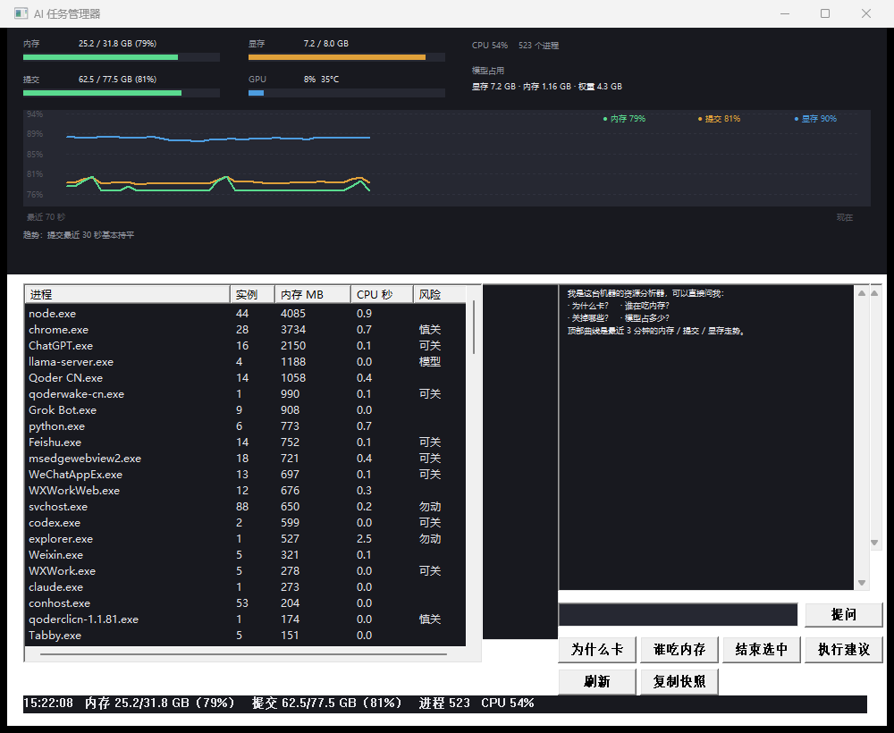
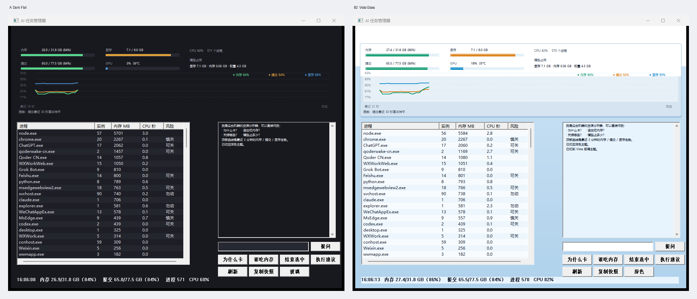
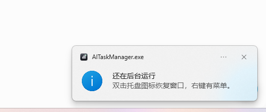
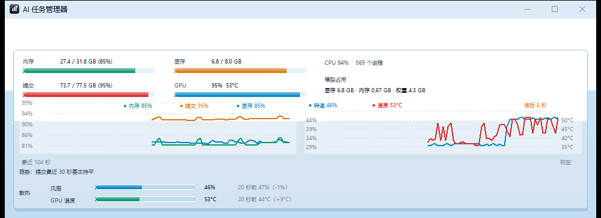
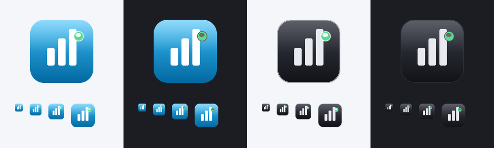
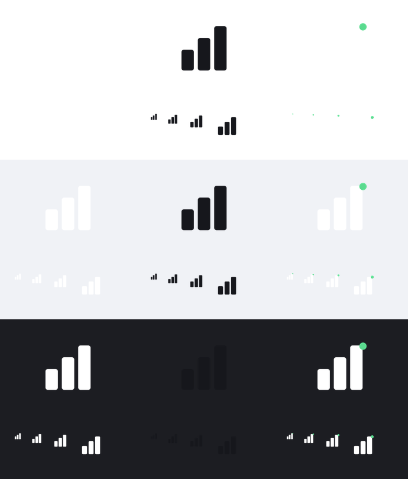

# AI 任务管理器（C++ / Win32）

[](https://github.com/Wike-CHI/ai-task-manager/actions/workflows/build.yml)
[](https://github.com/Wike-CHI/ai-task-manager/releases)
[](LICENSE)

**[下载最新版](https://github.com/Wike-CHI/ai-task-manager/releases/latest)** —— 解压/双击即用，绿色单文件，无需 .NET 或运行库。


原生 Win32 程序，**单个 exe，约 100 KB，无运行时依赖**。不是把任务管理器换个皮，
而是把"看数据"换成"要结论 + 能直接动手"。



## 它比任务管理器多什么

| 传统任务管理器 | 这个 |
|---|---|
| 一屏几十个进程，同名应用散成几十行 | **同名合并**（ChatGPT 19 个进程 → 1 行） |
| 只有数字 | 每行标 `模型 / 可关 / 慎关 / 勿动`，并给理由 |
| 你自己判断该关谁 | 直接给排序后的建议：`关掉 ChatGPT —— 释放 2.6 GB（对话在云端，重开无损）` |
| 关进程靠手速 | 「执行建议」一次关掉所有`可关`项，弹窗确认后执行；系统进程硬拦截 |

## 两套主题



| | A Dark Flat（默认） | B2 Vista Glass |
|---|---|---|
| 背景 | 纯 `#18191F` | 天蓝渐变 + 顶部白雾 + 椭圆柔光 |
| 卡片 | 实心 `#262832` | 圆角 10px、白 50% 半透明、上亮下暗双色边、2px 投影 |
| 列表 | 深底 + 斑马纹 | `#F7FBFE` 底 + 斑马纹（`#ECF6FC`），选中玻璃蓝 `#C6E2F5` |
| 进度条 | 纯色 | 玻璃胶囊：半透明色 + 上半段白色高光 + 圆角描边 |
| 字体色 | `#E6E6EB` | `#0F172A`（对比度 12:1） |

切换方式：右下角第二排第三个按钮，**三档循环**，按钮上写的是"下一档是什么"。

| 当前 | 按钮显示 | 点一下 |
|---|---|---|
| 深色 | `玻璃` | → 玻璃 |
| 玻璃 | `跟随系统` | → 跟随系统 |
| 跟随系统 | `深色` | → 深色 |

- **跟随系统**读 `HKCU\Software\Microsoft\Windows\CurrentVersion\Themes\Personalize\AppsUseLightTheme`：系统浅色 → 用玻璃，系统深色 → 用深色。
- 系统主题在运行中被切换（`WM_SETTINGCHANGE`）时，跟随档会立即重新解析并重绘。
- 选择和模式一起写进 `HKCU\Software\AITaskManager\theme`，值可为 `dark` / `glass` / `auto`。

命令行与环境变量仍然只影响当次启动，不覆盖记住的模式：

```
AITaskManager.exe dark | glass | auto
set AITM_THEME=auto
```

标题栏也一起换（Win11 22000+）：

| 主题 | 标题栏底 | 标题文字 | 窗口边框 |
|---|---|---|---|
| 深色 | `#18191F` | `#E6E6EB` | `#33353F` |
| 玻璃 | `#DCEBF7` | `#0F172A` | `#92BEDE` |

用 `DwmSetWindowAttribute` 的 `DWMWA_CAPTION_COLOR` / `DWMWA_TEXT_COLOR` / `DWMWA_BORDER_COLOR`（34/35/36）。
Win10 上这几个属性不支持，调用直接失败——不会报错，标题栏保持系统默认，其余照常。

**为什么不用系统亚克力（Acrylic）**：客户区是整块自绘的，亚克力透不出来，只剩 GPU 常驻开销；
而且会让窗口表面带 alpha，`PrintWindow` 截图整片发白。玻璃感全部由 GDI 渐变 + `AlphaBlend`
半透明 + 双色描边实现，零 GPU 成本，截图所见即所得。

## 托盘



- **点 × 不退出**，收进托盘继续采样（曲线不会断）
- **左键单击图标**在显示/隐藏之间切换，**右键**出菜单：显示窗口 / 立即刷新 / 退出
- 鼠标悬停看实时摘要：`内存 62% · 提交 55% · 显存 90%`
- 首次收起会弹一次说明气泡（Win11 默认把新图标藏在 `^` 溢出区里，不提示没人找得到）
- 托盘图标跟随主题（深色用亮图标、玻璃用暗图标）

真正的退出只有两条路：托盘菜单「退出」，或任务管理器结束进程。

## 温度与散热



| 传感器 | 来源 | 刷新 |
|---|---|---|
| GPU 温度、风扇转速 | `nvidia-smi --query-gpu=temperature.gpu,fan.speed` | 2 秒 |
| NVMe / SSD 温度 | `Get-StorageReliabilityCounter`（WMI） | 30 秒 |
| ACPI 热区温度 | `MSAcpi_ThermalZoneTemperature`（取最高那一个） | 30 秒 |

温度直接显示在状态栏，也会进分析：`· 温度：GPU 44°C（风扇 47%），磁盘 60°C，ACPI 28°C（GPU 20 秒内降 3°C，47→44）`。

曲线图下方是**散热对比条**：风扇转速和 GPU 温度用同样长度的条并排画（温度按 20~95°C 铺满整条），右边跟着「20 秒前」的数值和涨跌，所以「转速拉起来没有、温度压下去没有」是一眼对比，不用心算：

- 条的颜色就是这个指标的状态：蓝/绿正常，橙偏高，红告警
- 右侧直接给结论：散热轻松 / 散热余量充足 / 温度偏高风扇没拉满 / 高温高转散热受阻

右上角的**双轴曲线**专门看转速跟温度谁先动：左轴是风扇转速（%），右轴是 GPU 温度（°C），两条线共用同一条时间轴。工具会在最近 2 分钟里对 0~30 秒的各个位移做相关系数，取最相关的那个当**滞后**，直接标在右上角（`滞后 8 秒` / `两者同步` / `暂无可比`）——这是判断风扇曲线跟不跟得上负载的直观依据。

散热评估规则：

- GPU ≥83°C **且** 风扇 ≥85% → 散热可能受阻（积灰 / 风道 / 环境温度）
- GPU ≥83°C 但风扇没拉满 → 建议检查风扇曲线
- 风扇 ≥90% 而 GPU <60°C → 散热余量充足

### 关于「单独控制风扇」

**本工具不提供风扇控制**，这是 Windows 平台的限制，不是偷懒：

| 目标 | 可行性 |
|---|---|
| 显卡风扇 | `nvidia-smi` 在 Windows 下**只读**（本机已验证无 `--fan-speed`），要用 NVIDIA 控制面板或 MSI Afterburner |
| 主板 / CPU 风扇 | 无标准 API，需厂商工具（AI Suite / MSI Center / Lenovo Vantage）或进 BIOS 调曲线 |
| 通用方案 | 必须装内核驱动直接读写 Super I/O（如 WinRing0），会被杀软拦、有蓝屏风险 |

所以这里只做**读取 + 趋势 + 判断**：告诉你要不要关注散热，改转速还是交给厂商工具。

## 悬浮球


托盘菜单里的 **内存悬浮球**（默认开启）：

- 圆形小窗，始终置顶，显示当前物理内存占用百分比
- 外圈进度弧按水位变色：<80% 绿、80–90% 黄、>90% 红
- **拖动** 移动位置（位置写注册表，下次还在原处）
- **单击** 打开主窗口（4px 以内的位移算点击，不会误触发）
- **右键** 菜单：打开主窗口 / 隐藏悬浮球 / 退出

## 清理内存

托盘菜单 → **清理内存**：

```
整理完成：538 个进程，工作集减少 8.0 GB（转入备用内存，可立即复用）。
```

实现是遍历进程调 `EmptyWorkingSet`，跳过 PID≤4 和打不开的。
**注意口径**：报的是"工作集减少量"，不等于物理内存立刻多出这么多——
这部分页进了备用列表（standby），能被系统立即回收，但任务管理器里显示为"已缓存"。

## 时间轴


顶部是一条 **保留 3 分钟**（90 个采样点，每 2 秒一个）的曲线：

- 绿 = 物理内存占用，黄 = 提交内存，蓝 = 显存
- Y 轴**自动缩放**到数据实际范围（80%~92% 这种窄区间也能看出起伏），左侧标刻度和百分比
- 右上角图例带**当前值**，底部写「最近 N 秒」和趋势结论（`提交最近 30 秒基本持平 / 上升 X% 还在恶化`）
- 问一句「趋势」也能拿到同样的结论

## 不闪的三件事

| 手段 | 解决什么 |
|---|---|
| `WS_CLIPCHILDREN` | 父窗口重绘时不覆盖子控件区域，列表不再被刷白 |
| 双缓冲 + 只重绘顶部 | `BeginPaint` 里先画到内存 DC 再 `BitBlt`，且只 `InvalidateRect` 顶部 276px |
| `WM_ERASEBKGND` 返回 1 | 不让系统先擦一遍背景（闪白的元凶） |
| 列表 `WM_SETREDRAW` 包裹 | 重建 500+ 行时冻结重绘，最后一次性刷新；同时保留滚动位置和选中行 |

## 模型占用

右上角固定显示：

```
模型占用
显存 7.2 GB · 内存 1.16 GB · 权重 4.3 GB
```

- **显存**取 `nvidia-smi` 的总占用（模型在跑时基本都是它的）
- **内存**只统计 `llama-server.exe` 的 working set
- **权重**扫 `models/*.gguf` 的文件大小，启动时算一次

问「模型占多少」会给更细的解释，并提示"别按内存大小误杀"。

## 界面

```
┌ 内存 25.2/31.8 GB (79%) ▓▓▓▓▓░░   显存 7.2/8.0 GB ▓▓▓▓▓▓▓▓░ ┐
│ 提交 62.5/77.5 GB (81%) ▓▓▓▓▓▓░░   GPU  8% 35°C     ▓░░░░░░░░ │
│                                        CPU 54%  523 个进程     │
│                                    模型占用                    │
│                       显存 7.2 GB · 内存 1.16 GB · 权重 4.3 GB │
├────────────────────────────────────────────────────────────────┤
│ 94% ┤                                    ● 内存 79% ● 提交 81%  │
│ 88% ┤      ╭─────╮  ╭──╮                 ● 显存 90%            │
│ 82% ┤ ╭────╯     ╰──╯  ╰──────────────                        │
│ 76% ┼───────────────────────────────────────────────           │
│     最近 70 秒                                        现在     │
│ 趋势：提交最近 30 秒基本持平                                   │
├──────────────────────────────┬─────────────────────────────────┤
│ 进程        实例 内存MB CPU秒 风险 │ 我是这台机器的资源分析器…        │
│ node.exe    44   4085  0.9       │ 你：谁在吃内存？                 │
│ ChatGPT.exe 16   2150  0.1  可关 │ 1. node.exe     4085 MB × 44     │
│ llama-server 4   1188  0.0  模型 │ 2. ChatGPT.exe  2150 MB × 16[可关]│
│ …                                │ 建议：关掉 ChatGPT 释放 2.1 GB   │
├──────────────────────────────┴─────────────────────────────────┤
│ [为什么卡] [谁吃内存] [结束选中] [执行建议]   [提问]             │
│ [刷新] [复制快照]                                               │
└─────────────────────────────────────────────────────────────────┘
```

## 四个问题，直接问

输入框写问题点「提问」，或直接点按钮：

| 问题 | 回答内容 |
|---|---|
| 为什么卡 | 结论（内存/显存/正常）+ 依据（物理内存、提交、GPU）+ 内存前 5 + 排序建议 + 预计释放量 |
| 谁吃内存 | 内存前 8，含进程数和风险标记 |
| 关掉哪些 | 按「关掉无损」排序，逐条给理由和释放量 |
| 显存怎么样 | GPU 利用率、显存占用、温度，并说明"显存满不影响打字，内存才是" |

## 判断逻辑（不是拍脑袋）

- **优先看「提交」**，不是「内存」：32 GB 物理内存却有 77.5 GB 提交上限，一旦逼近，
  Windows 疯狂换页 → 磁盘打满、输入卡顿、翻译从 1 秒变几十秒。物理内存 84% 可能完全没事，
  提交 88% 已经很难受了。
- **风险分级**来自名称白名单：
  - `勿动`：csrss / winlogon / dwm / explorer / svchost / MsMpEng …（结束会炸）
  - `模型`：llama-server（吃显存，按内存排序会被误判成大内存户）
  - `可关`：ChatGPT / qoderwake / 飞书 / 企业微信 / WebView2（云端或可重建）
  - `慎关`：VS Code / Qoder / Cursor / Chrome（可能有未保存内容）
- **CPU 是按 pid 的增量**：每 2 秒采一次，取两次之间 `kernel+user` 的差，
  再按同名聚合。第一次采样显示 0，这是对的。

## 编译

```bat
build.bat
```

内部调用 VS 2022 的 `vcvars64.bat`，然后：

```bat
cl /std:c++17 /EHsc /O2 /utf-8 src\main.cpp /Fe:AITaskManager.exe ^
   user32.lib gdi32.lib comctl32.lib psapi.lib
```

产物：`AITaskManager.exe`（约 100 KB），双击即开，不需要 .NET / Python / 运行库。

## 图标



两套，**跟着主题自动切换**：

| | 底色 | 柱子 | 什么时候用 |
|---|---|---|---|
| **亮色版** | 蓝玻璃 `#38BDF8 → #0369A1` | 纯白 | 深色主题（深色标题栏上更醒目） |
| **暗色版** | 石墨 `#3A3E4A → #12131A` + 1px 白边 | 浅灰 `#E8EAF0` | 玻璃主题（浅色标题栏上用暗图标才不糊） |

共同元素：三根递增数据柱 + 右上绿色状态点（`#5ADA8F`），16px 仍可辨认。

资源里编了两个图标（`1` = 亮、`2` = 暗），切换主题时用 `WM_SETICON` 换成对应那个；
exe 文件本身的图标固定用 `1`，资源管理器里永远显示亮色版。

```bat
python tools/make_ico.py        :: 两套都重出 + 对比图
python tools/make_ico.py dark   :: 只出暗色
```

生成脚本 `tools/make_ico.py`：1024 画布超采样 → 逐级 LANCZOS 缩放到 16/20/24/32/40/48/64/128/256。

### 极简单色版（可选）



透明底、无边框、无渐变，只有柱子和点：

| 文件 | 颜色 | 适合 |
|---|---|---|
| `icon-mono-white.ico` | 纯白 | 深色标题栏 / 深色任务栏 |
| `icon-mono-dark.ico` | `#16171C` | 浅色背景 |
| `icon-mono-accent.ico` | 白柱 + 绿点 | 深色背景，想保留状态点语义 |

```bat
python tools/make_mono.py
```

注意：没有底板，**图形本身依赖背景对比**——纯白版放在白底上等于隐形，纯黑版放在深底上同理。
所以这套不适合当 exe 文件图标（资源管理器背景不可控），只适合已知背景的标题栏或托盘。

> 踩坑备忘：局部变量别叫 `small`，`rpcndr.h` 里 `#define small char`，会编译报 `HICON 后跟 = 非法`。

## 持续集成 / 发布

`.github/workflows/build.yml`：

| 触发 | 动作 |
|---|---|
| push 到 main / PR | 用 MSVC 编译，产物作为 artifact 存 30 天 |
| 打 `v*` 标签 | 编译后自动创建 Release，附上 `AITaskManager.exe` |

发新版流程：

```bash
git tag -a v0.1.1 -m "v0.1.1 — 修了什么"
git push origin v0.1.1
# 约 40 秒后 https://github.com/Wike-CHI/ai-task-manager/releases 出现新版本
```

Release 说明由 GitHub 自动生成（对比上个 tag 的提交），无需手写。

## 技术栈

| 项 | 选型 |
|---|---|
| 语言 | C++17 |
| UI | 原生 Win32 + ComCtl32（ListView report） |
| 采集 | ToolHelp32（进程）、PSAPI（内存）、GetSystemTimes（CPU）、GlobalMemoryStatusEx（内存/提交）、nvidia-smi（GPU） |
| 并发 | `std::thread` 后台采样 + `PostMessage` 回主线程，UI 不阻塞 |
| 依赖 | 无第三方库，纯系统 DLL |

## 边界

- 只支持 Windows；GPU 部分依赖 `nvidia-smi`（无 N 卡时显示「无 N 卡」）
- 采样间隔 2 秒，瞬时尖峰可能漏掉
- 「执行建议」只处理 `可关`，不会碰 `慎关` 和系统进程
